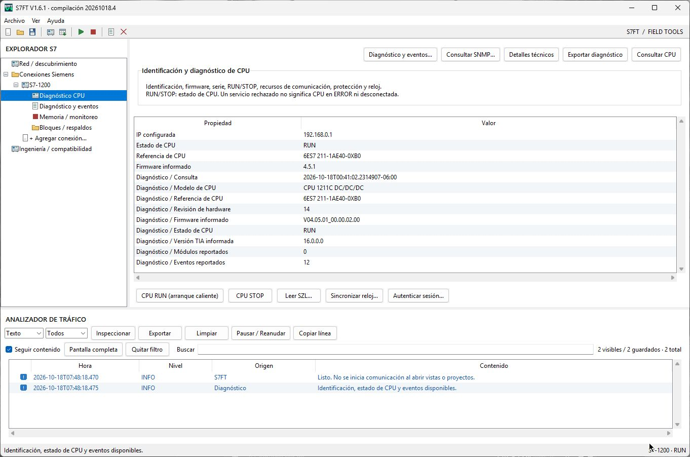
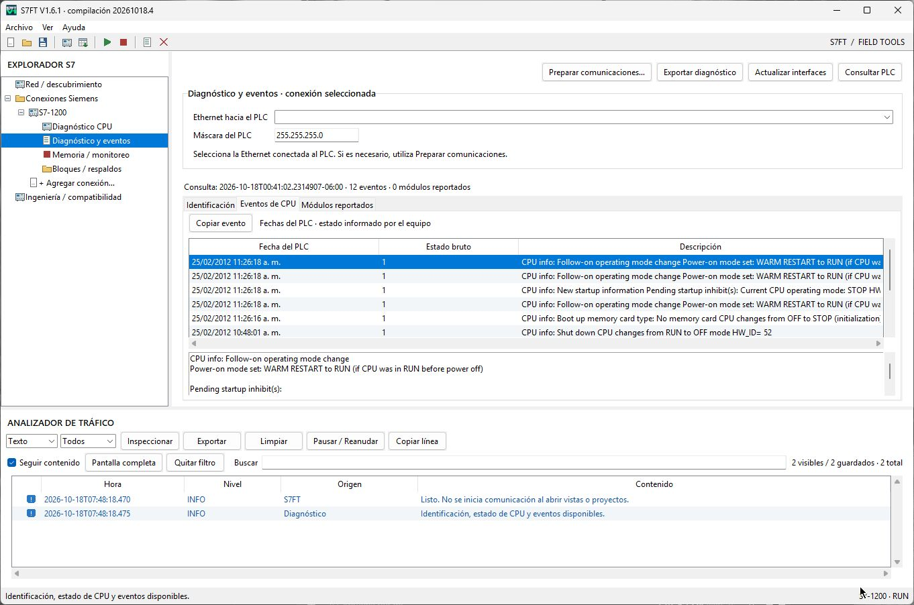

# S7FT

**Conoce el estado de tus PLC Siemens y agiliza el diagnóstico en campo.**

S7FT reúne descubrimiento de equipos, identificación, firmware, estado de CPU y eventos de diagnóstico en una aplicación de escritorio para Windows. Una herramienta de **Dysco Exploration and Production**, parte de **Field Tools de cloudLOGGER SCADA**.

**V1.6.1 · compilación 20261018.4 · Windows x64 · Interfaz en español**

[**Descargar S7FT para Windows x64**](https://github.com/DyscoEP/s7ft/releases/latest/download/S7FT-Windows-x64.zip)

[Guía de uso](docs/guia-de-uso.md) · [Requisitos](docs/prerrequisitos.md) · [Compatibilidad y ayuda](docs/limitaciones-y-problemas.md) · [Soporte](https://github.com/DyscoEP/s7ft/issues/new/choose)

## Funciones

| Función | Qué puedes hacer |
|---|---|
| Descubrimiento Ethernet | Localiza dispositivos en tu red y crea conexiones para consultarlos. |
| Identificación del PLC | Consulta modelo, referencia y firmware disponibles. |
| Estado de CPU | Visualiza RUN/STOP y el resultado de la comunicación. |
| Diagnóstico y eventos | Revisa identificación ampliada, módulos reportados y eventos de CPU; copia detalles y exporta informes. |
| Inventario de red | Consulta información de interfaces y propiedades de red disponibles en el equipo. |
| Memoria | Lee y escribe direcciones compatibles, según los permisos y configuración del PLC. |
| Bloques S7-300/400 | Consulta bloques y realiza respaldos binarios; carga o restaura bloques cuando el equipo lo permite. |
| Configuración de Ethernet | Comprueba la subred y añade una IP secundaria temporal cuando sea necesario. |
| Organización del trabajo | Guarda conexiones y proyectos, consulta el analizador de operaciones y exporta resultados. |

## Empieza a trabajar

1. Extrae el ZIP y ejecuta **S7FT.exe**.
2. Si la PC requiere preparación, abre **Ayuda → Preparar comunicaciones Siemens** y sigue las indicaciones. Puede requerir administrador y reinicio.
3. Crea una conexión con la IP del PLC y selecciona la Ethernet correspondiente.
4. Abre **Diagnóstico y eventos**, actualiza las interfaces y pulsa **Consultar PLC**.

La consulta de diagnóstico es manual. Seleccionar una vista o abrir un proyecto no inicia comunicación.

## Capturas

## Requisitos y compatibilidad

Windows 10/11 x64 y conexión Ethernet con acceso al equipo. El asistente incluido guía la preparación de comunicaciones. El descubrimiento Ethernet puede requerir un controlador adicional. Consulta [los requisitos](docs/prerrequisitos.md).

Las funciones disponibles dependen de la familia de CPU, firmware, permisos y configuración. S7FT no incluye edición LAD/FBD/SCL, carga de proyectos TIA para S7-1200/1500, actualización de firmware ni programación F-CPU. Los respaldos de bloques no equivalen a un proyecto fuente.

## Descarga y soporte

El ZIP oficial contiene **S7FT.exe**, **LEEME.txt**, **LICENSE.txt** y **THIRD-PARTY-NOTICES.txt**. Conserva los avisos junto al programa. Verifica la integridad con [S7FT-SHA256SUMS.txt](https://github.com/DyscoEP/s7ft/releases/latest/download/S7FT-SHA256SUMS.txt).

Descarga el programa desde **Releases**. Los archivos automáticos «Source code» de GitHub contienen la documentación de este repositorio.

[Reportar un fallo o sugerir una mejora](https://github.com/DyscoEP/s7ft/issues/new/choose) · [Condiciones y licencia](LICENSE.txt) · [Avisos de terceros](THIRD-PARTY-NOTICES.txt)

[cloudLOGGER SCADA](https://cloudloggerscada.com) · [Dysco Exploration and Production](https://dyscoep.com/descargas/s7ft/)
